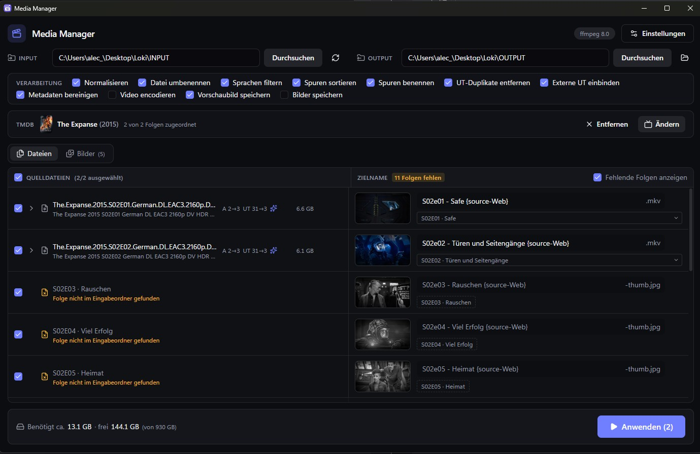
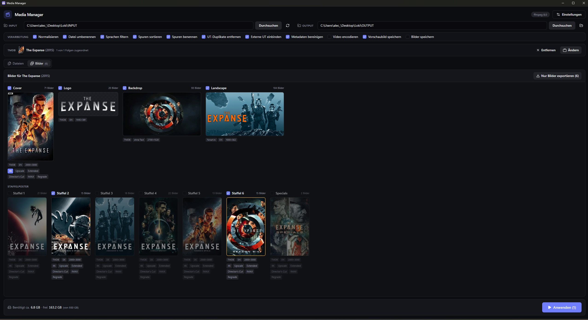
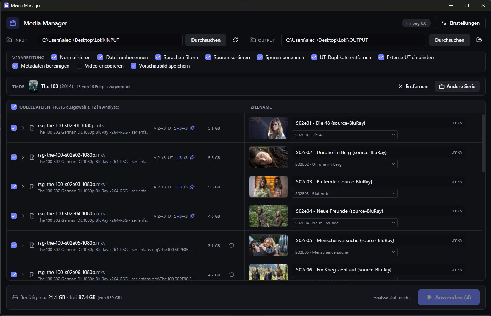
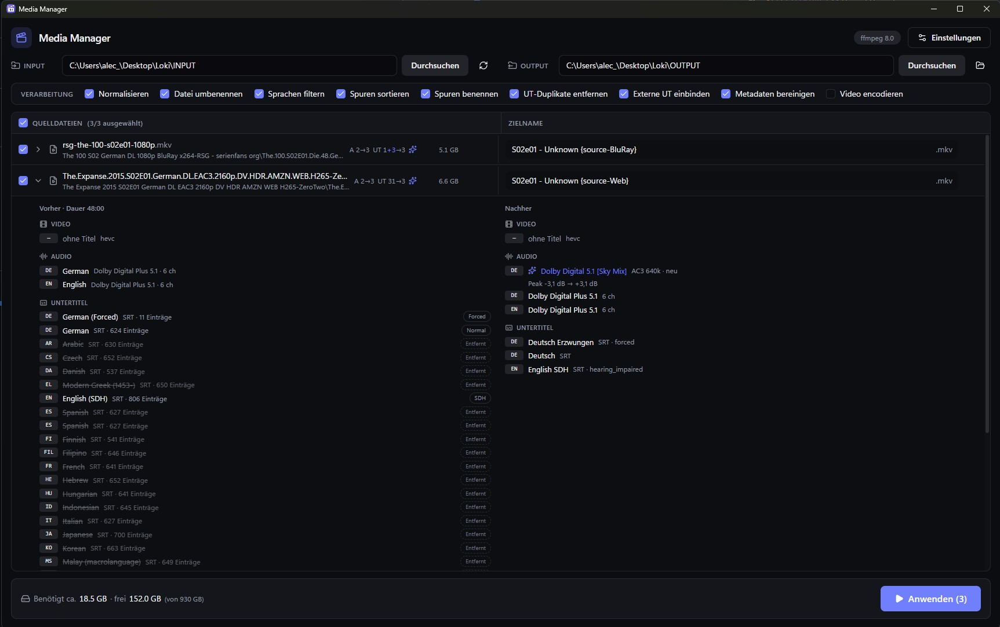

# Media Manager

[](package.json)
[](https://www.electronjs.org)
[](https://react.dev)
[](https://www.typescriptlang.org)
[](https://vite.dev)
[](https://tailwindcss.com)
[](https://ffmpeg.org)
[](https://pnpm.io)

Eine Desktop-App für Windows, die Serien- und Filmdateien für die eigene Mediathek aufbereitet. Sie liest einen Input-Ordner ein, schlägt für jede Datei einen einheitlichen Namen vor und baut daraus eine neue MKV im Output-Ordner: mit sortierten und sauber benannten Ton- und Untertitelspuren, einer lautstärke-normalisierten Tonspur und eingebundenen externen Untertiteln. Die Quelldateien bleiben dabei unverändert.



Links stehen die gefundenen Dateien, rechts die Zielnamen. Jede Datei lässt sich ausschließen, jeder Name bearbeiten, und pro Datei zeigt eine aufklappbare Übersicht, welche Spuren vorher da sind und welche in der fertigen Datei landen. Ein Klick auf **Anwenden** verarbeitet alles.

Die App ist der Nachfolger meiner früheren Konsolen-Version, in der alle Einstellungen im Code standen. Deren Logik wurde übernommen und dabei an mehreren Stellen korrigiert.

## Features

- 📂 **Dateien**
  - Rekursiver Scan nach `.mkv`, `.mp4` und `.avi`; Dateien mit `sample` im Namen werden ignoriert
  - Dateien per Checkbox ausschließen, einzeln oder alle auf einmal
  - Aufklappbare Spurübersicht vorher → nachher, inklusive Peak-Wert der Tonspur und Anzahl der Untertitel-Einträge
  - Die Liste steht nach wenigen Sekunden, auch bei einer ganzen Staffel: Beim Einlesen werden nur die Kopfdaten gelesen
  - Was die ganze Datei braucht (Peak-Analyse und Untertitel-Zählung), läuft danach im Hintergrund in einem gemeinsamen Durchgang pro Datei; Uhr = wartet, Spinner = läuft, der Fortschritt steht in der Kopfzeile der Tabelle. Anwenden geht schon vorher, fehlende Scans werden dann vorgezogen
- ✏️ **Renaming**
  - Schema `S01e02 - Titel {edition-…} {source-…}.mkv`, Staffel und Folge zweistellig; ohne Titel steht `Unknown`
  - Filme: `Titel (Jahr) {edition-…} {source-…}.mkv` für die größte Datei ohne Episodenangabe, Extras behalten ihren Namen
  - Erkennt `S01E02`, `1x02` und alleinstehende `E01`
  - Edition aus dem Dateinamen: Extended, Upscale, Extended-Upscale, Director's Cut
  - Quelle aus dem Dateinamen, ersatzweise aus den Ordnernamen innerhalb des Input-Ordners: Disney+, Amazon, Netflix, ATVP, RTL+, Web, UHD, BluRay
  - Zielnamen direkt in der Liste bearbeitbar, mit Knopf zum Zurücksetzen auf den Vorschlag
  - Konflikte werden rot markiert und beim Anwenden übersprungen: Datei existiert schon, Name doppelt, ungültige Zeichen
- 🔊 **Tonspuren**
  - Filtern nach Sprachen, sortieren nach Sprache, Kanalzahl und Format
  - Einheitliche Titel wie „Dolby Digital Plus 5.1“; Atmos, DTS:X, DTS-HD MA und DTS-HD HR werden über MediaInfo erkannt
  - Peak-Normalisierung: Die erste Tonspur wird gemessen (`volumedetect`) und als zusätzliche AC3-Spur (Stereo 384k, 5.1 640k) vorne eingefügt, mit einstellbarem Branding im Titel, z. B. „Dolby Digital 5.1 [Sky Mix]“
  - Mindest- und Maximal-Gain einstellbar, unterstützte Formate und Kanalzahlen per Checkbox
  - Der Peak wird im Hintergrund gemessen, während man die Liste durchsieht; beim Anwenden muss dann nur noch geschrieben werden
- 💬 **Untertitel**
  - Externe Untertitel aus einem `Subs`-Ordner oder gleichnamige Dateien neben dem Video: `.idx/.sub` (VobSub), `.srt`, `.ass`, `.ssa`, `.sup` (PGS)
  - Sprache aus der Datei selbst oder aus dem Dateinamen (`-eng`, `.de`, `german` …), Forced und SDH ebenfalls aus dem Dateinamen
  - Nicht markierte Forced-Spuren werden an ihren wenigen Einträgen erkannt (unter 1,5 pro Minute); bis die Einträge im Hintergrund gezählt sind, ist der Typ vorläufig
  - Pro Spur ein Chip mit dem Typ: Entfernt, Normal, Forced, SDH oder CC. Blau = von der App erkannt, grau = laut Datei, orange = manuell überschrieben; Linksklick schaltet weiter, Rechtsklick zurück
  - Manuell gewählte Spuren kommen immer in die Datei, auch wenn ihre Sprache nicht in der Liste steht
  - Pro Sprache und Typ bleibt nur die bevorzugte Spur, nach einstellbarer Format-Reihenfolge
  - Einheitliche Titel wie „Deutsch Erzwungen“ oder „English SDH“ mit passenden Markierungen; Schriften für ASS-Untertitel werden mitkopiert, MP4-Untertitel nach SRT umgewandelt
- 🎞️ **TMDB**
  - Serie oder Film einmal bei [TMDB](https://www.themoviedb.org) suchen und zuordnen; Suchbegriff und Jahr werden aus Ordner- und Dateiname vorbelegt
  - Jede Folge bekommt per Staffel und Folge ihren Titel, auf Deutsch und ohne Übersetzung auf Englisch
  - Pro Datei lässt sich die Episode per Dropdown umstellen, z. B. wenn TMDB eine Doppelfolge als eine Episode führt; Rechtsklick aufs Dropdown setzt wieder die erkannte Folge
  - Links neben dem Zielnamen steht das Episodenbild, beim Überfahren groß (520 px)
  - Viele Folgen haben bei TMDB mehrere Bilder: Klick aufs Episodenbild öffnet die Auswahl mit allen Bildern der Folge, Rechtsklick stellt das Standardbild wieder her; manuell gewählte Bilder sind orange umrandet
  - Optional wird das gewählte Episodenbild als `<Zielname>-thumb.jpg` neben der Datei gespeichert (wie es Jellyfin, Emby und Kodi erwarten), größere Bilder verkleinert auf höchstens 1920×1080
- 🧩 **Fehlende Folgen**
  - Die Episodenliste von TMDB wird mit den Dateien abgeglichen, nur für die Staffeln, die in den Dateien vorkommen; im Kopf der Liste steht z. B. „2 Folgen fehlen“ (die Folgen im Tooltip)
  - Doppelte Zuordnungen fallen auf: „S02E03 doppelt“ im Kopf und ein Warnsymbol an den betroffenen Dateien (abgewählte Dateien zählen dabei nicht)
  - Fehlende Folgen erscheinen wie Dateizeilen an ihrer Stelle in der Liste, mit dem Hinweis „Folge nicht im Eingabeordner gefunden“ (bei noch nicht ausgestrahlten mit Termin); abschaltbar über **Fehlende Folgen anzeigen**
  - Angehakt (standardmäßig aus) wird ihr Episodenbild schwarz-weiß mit Vignette als `<Zielname>-thumb.jpg` exportiert, praktisch z. B. bei Animes mit noch nicht verfügbaren Folgen; Edition und Quelle im Namen kommen von der Nachbardatei
  - Geschrieben beim Anwenden (mit **Vorschaubild speichern**) oder über **Nur Bilder exportieren**; das Bild lässt sich wie bei Dateien per Klick ändern
- 🖼️ **Bilder**
  - Eigener Tab für Cover, Logo, Backdrop, Landscape und die Poster aller Staffeln, mit Vorschlägen von TMDB und [Fanart.tv](https://fanart.tv); angehakt sind nur die Staffeln, die in den Dateien vorkommen
  - Standardbild ist immer zuerst ein TMDB-Bild, danach Fanart.tv; jeweils Deutsch vor Englisch, Backdrops ohne Text zuerst
  - Bei Landscape stehen nach den Landscape-Bildern von Fanart.tv auch alle Backdrops zur Wahl, die mit Text zuerst (markiert mit „Backdrop“)
  - Klick aufs Bild öffnet die Auswahl mit Quelle, Sprache und Auflösung (bei Fanart.tv nach dem Laden gemessen), Rechtsklick stellt das Standardbild wieder her; manuelle Wahl ist orange markiert, jedes Bild lässt sich per Haken vom Export ausnehmen
  - Cover und Staffelposter werden immer 600×900 groß, gestreckt statt beschnitten
  - Overlays fürs Cover: 4K, Upscale, Extended, Director's Cut, IMAX und Regrade, auch mehrere gleichzeitig (z. B. Extended + Upscale); vorbelegt aus den Dateinamen, Extended und Director's Cut schließen sich aus, IMAX und Regrade teilen sich die Ecke unten rechts
  - Staffelposter haben standardmäßig keine Overlays, lassen sich aber einzeln setzen (Rechtsklick auf die Overlays entfernt sie wieder)
  - Backdrop und Landscape höchstens 1920×1080, Logos unverändert als PNG
  - Gespeichert wird beim Anwenden (Option **Bilder speichern**) oder über **Nur Bilder exportieren**, mit den Namen, die Jellyfin und Emby im Serien- bzw. Filmordner erwarten: `cover.jpg`, `season01-poster.jpg`, `season-specials-poster.jpg`, `logo.png`, `backdrop.jpg`, `landscape.jpg`
- 🎬 **Video & Metadaten**
  - Video wird verlustfrei kopiert oder optional neu encodiert (H.264, H.265, NVIDIA, Intel QSV, AV1) mit eigenen Encoder-Argumenten
  - Container- und Videotitel werden geleert, eine gleichnamige `.txt` neben der Datei wird als Beschreibung übernommen
- ⚡ **Ausführung**
  - Mehrere Dateien gleichzeitig, einstellbar von 1 bis 4 (Standard 2; für normale Festplatten 1)
  - Fortschritt pro Datei und gesamt mit Restzeit, jederzeit abbrechbar
  - Jede Datei wird erst als `.partial` geschrieben und nach Erfolg umbenannt; Fehler betreffen nur die eine Datei
  - Speicherplatz-Warnung über dem Anwenden-Knopf: gelb, wenn nach dem Export weniger als die Warnschwelle frei bliebe, rot, wenn der Platz nicht reicht
- ⚙️ **Einstellungen**
  - Werden sofort gespeichert und beim Beenden gesichert
  - Reihenfolgen (Sprachen, Audio-Formate, Untertitel-Typen und -Formate) per Drag & Drop, Auswahlfelder statt Freitext
  - Pfad zu ffmpeg und ffprobe frei wählbar, sonst aus dem PATH; die gefundene Version steht oben rechts
- 🩺 **Corruption-Checker**
  - Eigenes Konsolen-Tool, das eine Datei oder einen ganzen Ordner mit ffmpeg auf Container- und Streamfehler prüft, auf Wunsch mit vollständigem Decode-Test und Hardwarebeschleunigung

## Bedienung

1. **Input** und **Output** wählen. Beide Ordner werden gespeichert und beim nächsten Start wieder geöffnet.
2. Unter **Verarbeitung** die gewünschten Schritte an- oder abschalten.
3. Links Dateien ausschließen, die nicht verarbeitet werden sollen. Über den Pfeil vor einer Datei öffnet sich die Spurübersicht; dort lassen sich Untertitel per Klick auf den Chip übernehmen, entfernen oder umtypisieren.
4. Über **Serie / Film zuordnen** die Serie oder den Film bei TMDB auswählen. Die Titel landen automatisch in den Zielnamen; bei Serien lässt sich unter jedem Namen die Episode umstellen und per Klick aufs Episodenbild ein anderes Bild wählen.
5. Im Tab **Bilder** Cover, Logo, Backdrop, Landscape und Staffelposter prüfen und die Overlays fürs Cover setzen.
6. Rechts die Zielnamen prüfen und bei Bedarf von Hand anpassen.
7. **Anwenden** klicken. Fertige Dateien werden grün markiert, übersprungene und fehlerhafte zeigen ihren Grund im Tooltip.

Die Einstellungen liegen in `%APPDATA%\.media-manager\settings.json`.

### TMDB-API-Key

Für die Folgentitel braucht die App einen kostenlosen API-Key von TMDB: Konto auf [themoviedb.org](https://www.themoviedb.org) anlegen, unter [Einstellungen → API](https://www.themoviedb.org/settings/api) einen Key erzeugen und ihn in der App unter **Einstellungen → TMDB** eintragen. Akzeptiert werden der API-Key (v3) und der Read Access Token.

This product uses the TMDB API but is not endorsed or certified by TMDB.

### Fanart.tv-API-Key

Optional für mehr Cover, Staffelposter, Logos und Backdrops sowie für Landscape-Bilder, die es nur dort gibt: Konto auf [fanart.tv](https://fanart.tv) anlegen, unter [Get an API key](https://fanart.tv/get-an-api-key/) einen persönlichen Key erzeugen und ihn unter **Einstellungen → Fanart.tv** eintragen. Ohne Key kommen alle Bilder von TMDB.

## Development

### Voraussetzungen

- Node.js 22 oder neuer und pnpm 10
- ffmpeg und ffprobe (getestet mit 8.0) im PATH oder als Pfad in den Einstellungen

### Befehle

```bash
pnpm install     # Abhängigkeiten installieren
pnpm dev         # App im Entwicklungsmodus starten
pnpm build       # Produktions-Build nach out/
pnpm typecheck   # TypeScript prüfen
pnpm test        # Unit-Tests (Vitest)
pnpm dist        # portable .exe nach dist/MediaManager-<version>-portable.exe
```

Falls Electron nach `pnpm install` fehlt (`node_modules/electron/dist` leer): `node node_modules/electron/install.js`.

### Portable .exe

`pnpm dist` baut mit electron-builder eine einzelne `.exe`, die ohne Installation läuft. ffmpeg und ffprobe sind nicht enthalten, die Overlays aus `resources/overlays` schon. Die Konfiguration steht in `electron-builder.yml`; das App-Icon liegt als Quelle in `build/icon.svg`, daraus erzeugt sind `build/icon.ico` und `build/icon.png`.

### Corruption-Checker

```bash
pnpm check -- "P:\Filme"                       # schneller Check (Container)
pnpm check -- "P:\Filme\Film (2015).mkv"       # einzelne Datei
pnpm check -- "P:\Filme" --full                # vollständiger Decode-Test
pnpm check -- "P:\Filme" --full --gpu=cuda     # mit Hardwarebeschleunigung (cuda, qsv, d3d11va)
```

### Struktur

- `src/shared/`: reine Logik ohne Electron (Spurplanung, Renaming, externe Untertitel, TMDB-Zuordnung, fehlende Folgen, Bilder und Overlays, ffmpeg-Argumente, Platzschätzung), getestet in `tests/`
- `src/main/`: Electron-Main-Prozess (Ordner-Scan, ffprobe und MediaInfo, Hintergrund-Scan für Peak und Untertitel-Zählung, TMDB- und Fanart.tv-Abfragen, Bilder rendern, Ausführung, Einstellungen)
- `src/preload/`: typisierte Brücke `window.api` zwischen Oberfläche und Main-Prozess
- `src/renderer/`: React-Oberfläche mit Tailwind CSS und shadcn/ui-Komponenten
- `resources/overlays/`: die Overlay-PNGs (600×900) für Cover und Staffelposter
- `scripts/corruption-checker.ts`: der Corruption-Checker

## Changelog

1.0.3 | Fehlende Folgen

- Abgleich mit TMDB: fehlende Folgen der erkannten Staffeln werden angezeigt, doppelt zugeordnete Folgen markiert
- Fehlende Folgen erscheinen an ihrer Stelle in der Dateiliste (abschaltbar über „Fehlende Folgen anzeigen“)
- Angehakte fehlende Folgen bekommen ihr Vorschaubild schwarz-weiß mit Vignette exportiert, z. B. für noch nicht verfügbare Anime-Folgen


1.0.2 | Artwork

- Fanart.tv Integration (API-Schlüssel in Settings hinterlegen)
- Verwaltung von Artwork wie Cover, Backdrop oder den Season-Bildern samt Overlays für z. B. 4K, Upscale



1.0.1 | TheMovieDatabase Integration

- Exportieren von Thumbnails
- Thumbnail Auswahl
- Folgentitel können von TMDB zugewiesen werden, um sich das anschließende korrigieren zu sparen



1.0.0 | Basis



## Verwendete Bibliotheken

- [mediainfo.js](https://github.com/buzz/mediainfo.js) (BSD-2-Clause) für die genaue Formaterkennung der Tonspuren
- [Radix UI](https://www.radix-ui.com) und [shadcn/ui](https://ui.shadcn.com) (MIT) für die Bedienelemente
- [dnd kit](https://dndkit.com) (MIT) für die sortierbaren Listen
- [Lucide](https://lucide.dev) (ISC) für die Icons
- [Zustand](https://github.com/pmndrs/zustand) (MIT) für den App-Zustand

FFmpeg wird nicht mitgeliefert, sondern als installiertes Programm aufgerufen. Folgentitel und Episodenbilder stammen von [TMDB](https://www.themoviedb.org).
